# Heitorzin PCs

Sistema web completo para uma **loja de peças de computador**, com vitrine pública, cadastro/login de clientes, carrinho, pedidos e painel administrativo com 6 CRUDs.

| | |
|---|---|
| **Integrante** | Heitor Almeida Souza |
| **Tema da loja** | Peças para computador (processadores, placas de vídeo, memórias, SSDs, gabinetes, periféricos) |
| **Identidade visual** | Preto e branco listrado (inspirado em listras verticais, com logo própria) |
| **Repositório** | _COLE AQUI O LINK DO SEU GITHUB_ |

## Descrição do sistema

A **Heitorzin PCs** permite que clientes naveguem pelo catálogo, busquem e filtrem produtos, montem um carrinho e finalizem pedidos. Os administradores acessam um painel protegido por login para gerenciar produtos, categorias, fornecedores, clientes, usuários e pedidos, além de acompanhar um dashboard e um relatório de vendas.

## Tecnologias utilizadas

PHP 8 (POO) · MySQL · PDO (prepared statements) · Arquitetura MVC · HTML5 · CSS3 · JavaScript (puro) · Git/GitHub

## Estrutura do projeto (MVC)

```
heitorzin-pcs/
├── app/
│   ├── core/          # Router, Controller, CrudController, Model, Database (PDO), Auth, Upload, helpers
│   ├── models/        # Usuario, Cliente, Categoria, Fornecedor, Produto, Pedido
│   ├── controllers/   # Home, Auth, Carrinho, Conta, Dashboard, Relatorio + CRUDs do admin
│   └── views/         # layouts, loja, auth, conta, admin
├── config/config.php  # dados de conexão com o banco
├── database/heitorzin_pcs.sql   # criação do banco, tabelas, FKs e dados de teste
├── public/            # ÚNICA pasta acessível pelo navegador (index.php, assets, uploads)
└── docs/              # regras de negócio, roteiro do vídeo e prints
```

## Diagrama de classes (UML)

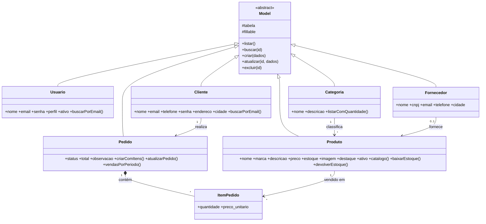

Controllers: `Controller` (base) → `CrudController` (CRUD genérico) → `Produto/Categoria/Fornecedor/Cliente/UsuarioController`; `PedidoController`, `DashboardController` e `RelatorioController` herdam de `Controller`.

## Modelo do banco de dados

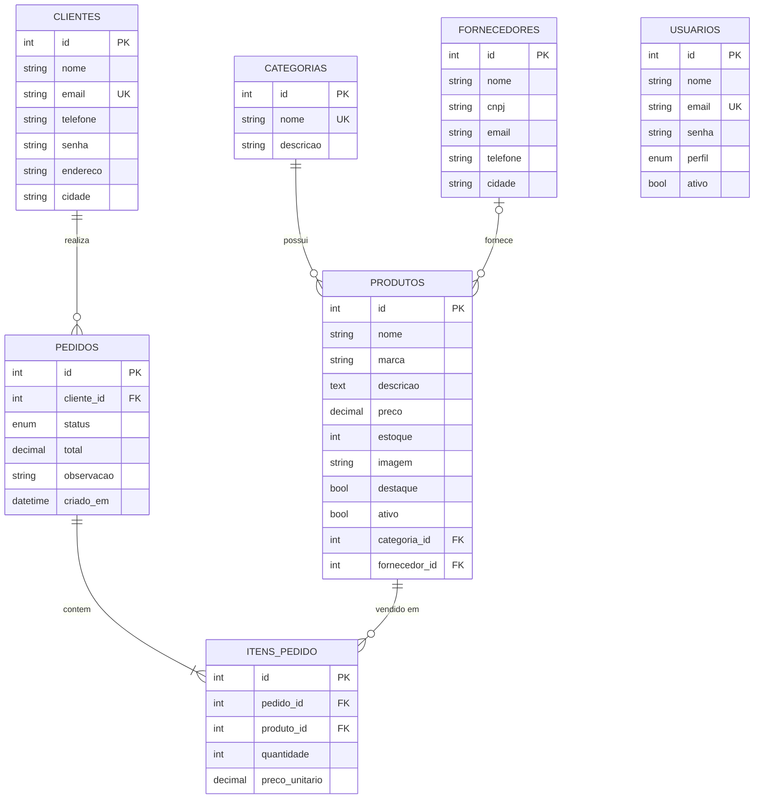

O script completo está em [`database/heitorzin_pcs.sql`](database/heitorzin_pcs.sql). As regras de negócio estão em [`docs/REGRAS_DE_NEGOCIO.md`](docs/REGRAS_DE_NEGOCIO.md).

## Como instalar e executar (XAMPP / Windows)

1. Instale o **XAMPP** (PHP 8.x) e abra o painel; clique em **Start** em **Apache** e **MySQL**.
2. Copie a pasta `heitorzin-pcs` para `C:\xampp\htdocs\`.
3. Abra `http://localhost/phpmyadmin` → aba **Importar** → escolha `database/heitorzin_pcs.sql` → **Importar**. (Isso cria o banco `heitorzin_pcs` com dados de teste.)
4. Se o seu MySQL tiver senha, edite `config/config.php` (`DB_USER` / `DB_PASS`). No XAMPP padrão é `root` sem senha.
5. Acesse **http://localhost/heitorzin-pcs/public/**

Alternativa sem Apache (precisa de PHP e MySQL no PATH):
```bash
cd heitorzin-pcs/public
php -S localhost:8000
# abrir http://localhost:8000
```

## Usuário e senha de teste

| Perfil | E-mail | Senha |
|---|---|---|
| Administrador | `admin@heitorzinpcs.com` | `admin123` |
| Gerente | `gerente@heitorzinpcs.com` | `admin123` |
| Cliente | `cliente@teste.com` | `cliente123` |

## Funcionalidades implementadas

**Obrigatórias**
- Página inicial pública com dados do banco (destaques, categorias, lançamentos)
- Registro de clientes (nome, e-mail, telefone, senha) e login/logout
- Senhas com `password_hash()` / `password_verify()` · sessão com `session_regenerate_id`, expiração e cookie HttpOnly
- Área administrativa protegida por login e perfil (admin / gerente)
- **6 CRUDs completos:** Usuários, Clientes, Categorias, Fornecedores, Produtos e Pedidos

**Extras (mais de 3)**
- Busca de produtos · filtro por categoria · ordenação por preço/nome
- Página de detalhes do produto
- Upload de imagem (validação do tipo real, limite de 2 MB, nome aleatório)
- Carrinho de compras (sessão) e finalização de pedido
- Controle de estoque automático (baixa na venda, devolução ao cancelar/excluir)
- Dashboard administrativo com indicadores e gráfico de receita
- Relatório de vendas com filtro por período, mais vendidos e exportação CSV
- Validação de formulários com JavaScript + validação no servidor · máscara de telefone

**Segurança:** PDO com prepared statements (anti SQL Injection), `htmlspecialchars` em toda saída (anti XSS), token CSRF em todos os formulários POST, controle de acesso por perfil.

## Prints das principais telas

| Início | Catálogo |
|---|---|
| 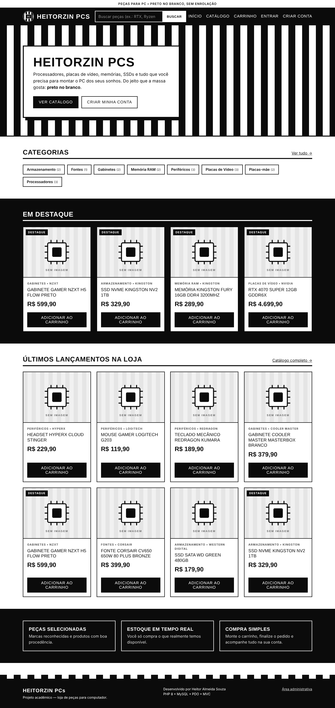 | 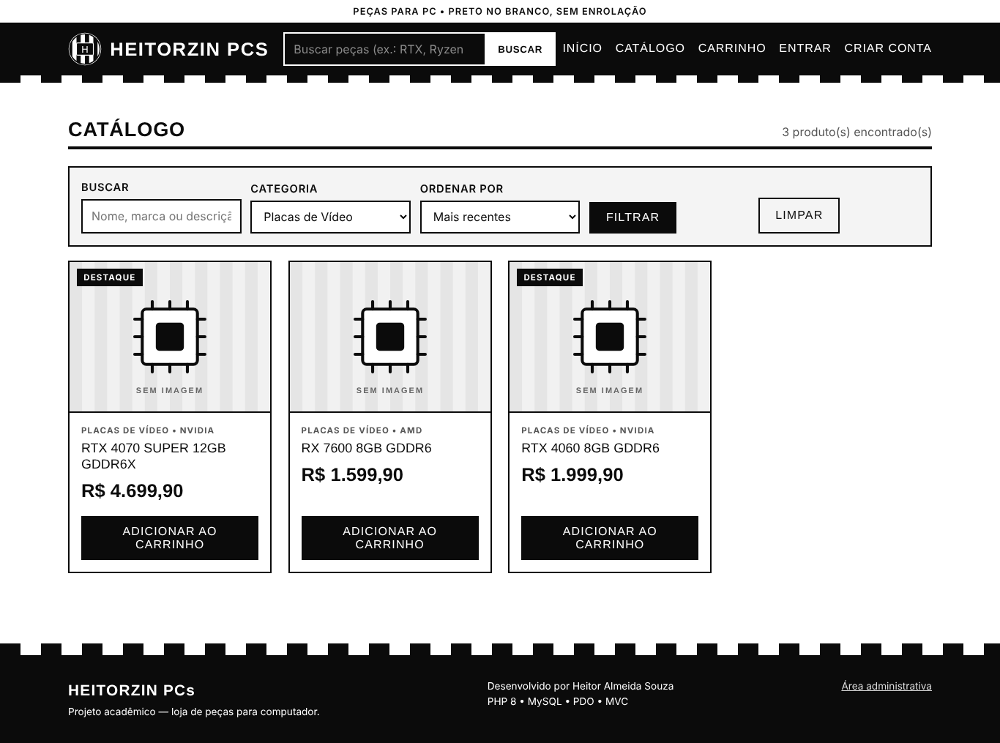 |

| Produto | Carrinho |
|---|---|
|  | 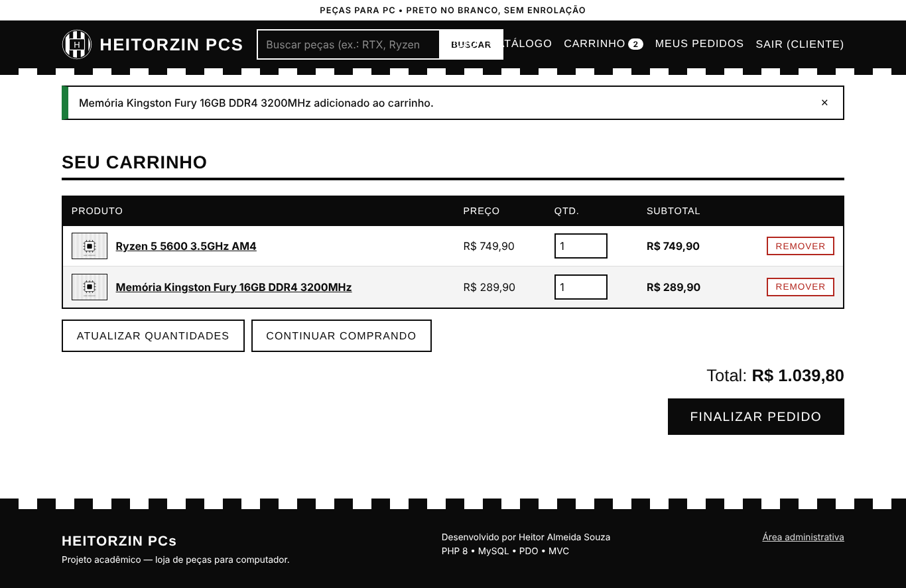 |

| Login | Registro |
|---|---|
| 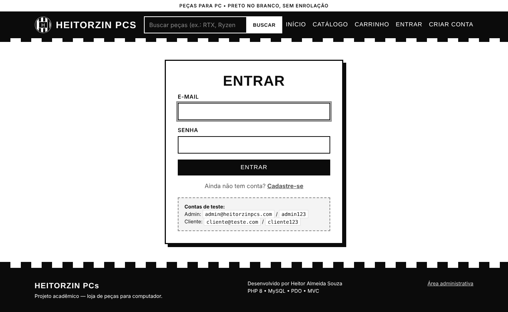 | 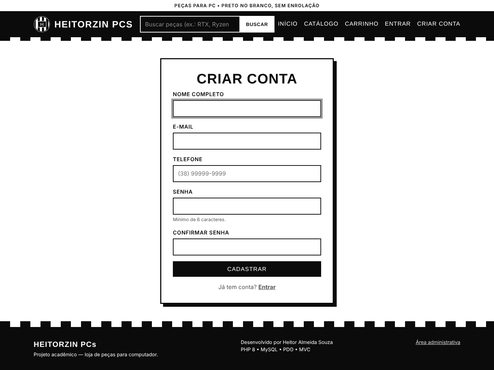 |

| Dashboard | Produtos (CRUD) |
|---|---|
| 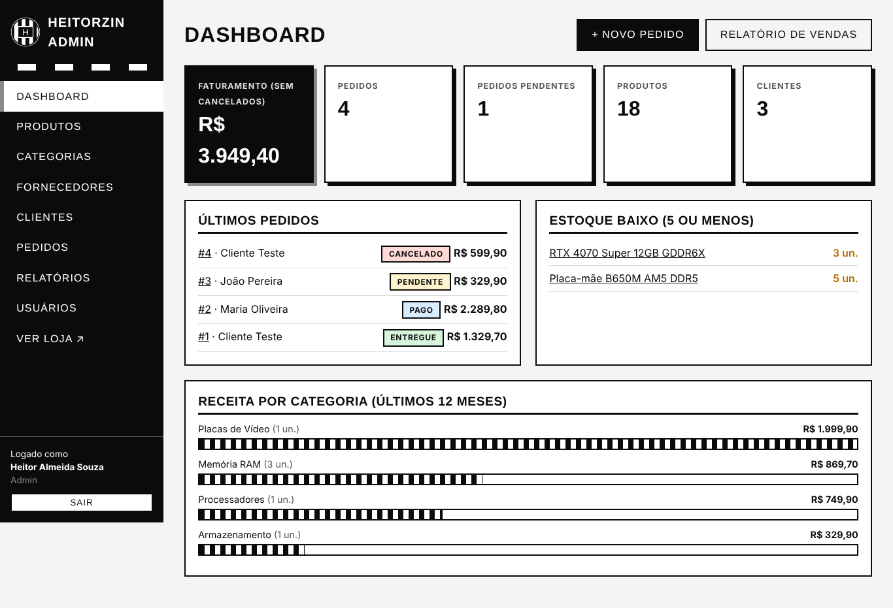 | 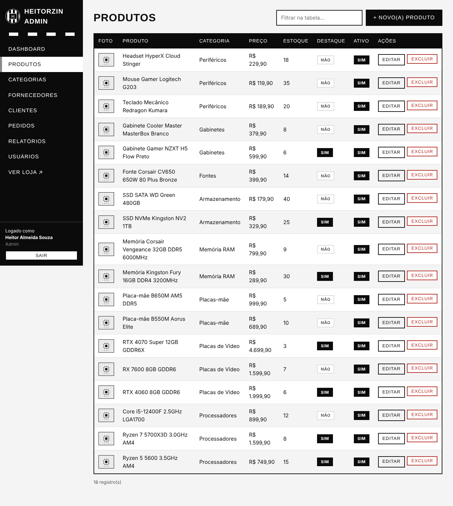 |

| Formulário de produto | Novo pedido |
|---|---|
| 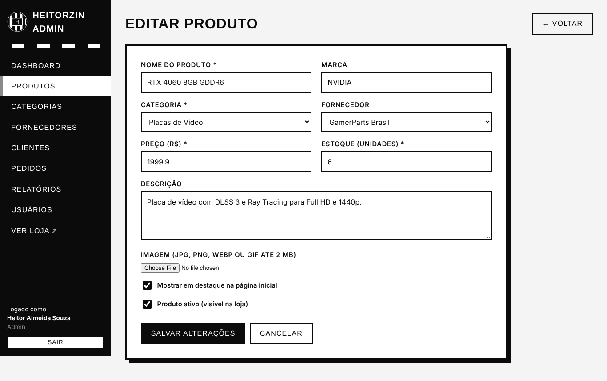 | 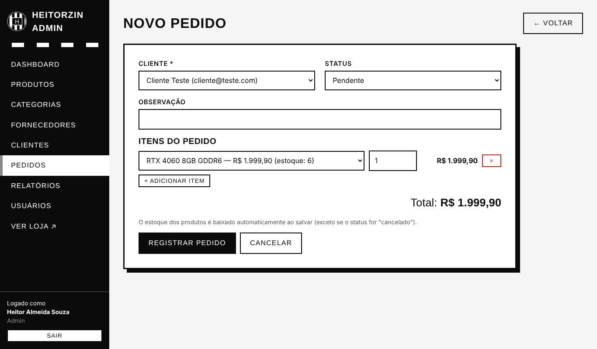 |

| Relatório de vendas | Pedidos |
|---|---|
| 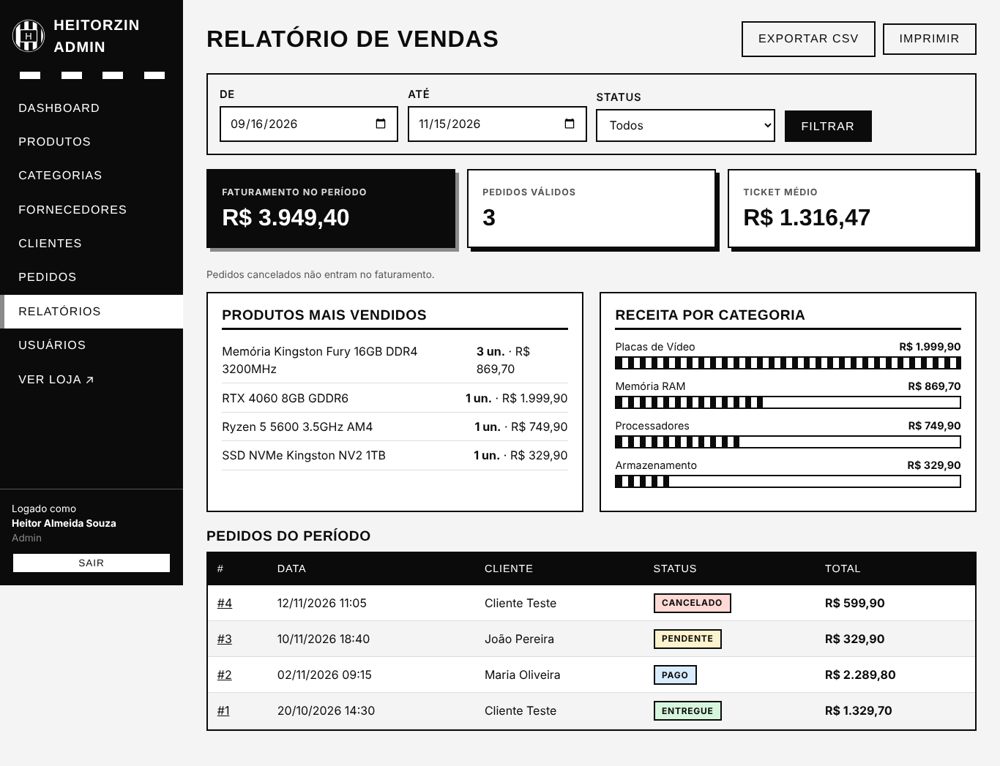 | 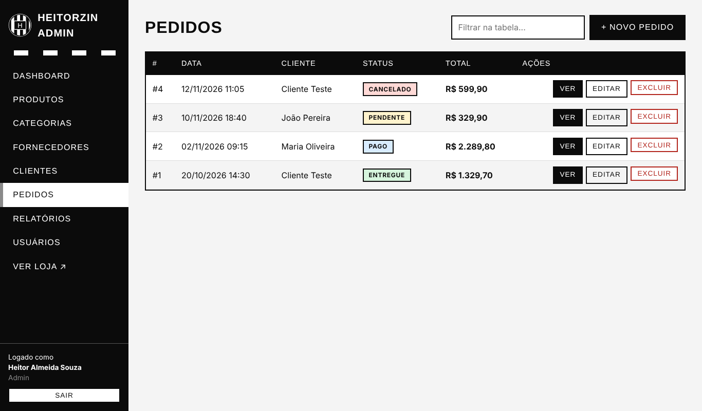 |

Demais prints em [`docs/prints/`](docs/prints/).

## Autor

Heitor Almeida Souza
